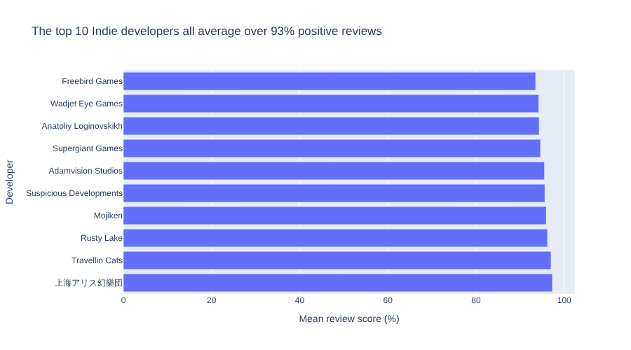

# 5. Summarising Groups in SQL

!!! learn "In this lesson we will learn"
    - how to summarise groups of records with `GROUP BY`
    - how to keep only some groups with `HAVING`
    - the difference between `WHERE` and `HAVING`
    - how `GROUP BY` matches Polars' `group_by` and `agg`
    - how to chart the answer to a query with Plotly

## Introduction

In [Summarising Groups](../insights/08_summarising_groups.md), we found the first evidence for our data story by splitting the games into groups and summarising each group: **split, apply, combine**. SQL does the same with `GROUP BY`. In this lesson we'll recreate our Indie numbers in SQL, then go further and compare developers.

Start marimo with `marimo edit sql_intro.py`, and run the connection cell so `conn` is ready.

## Indie and not Indie

Our example question compares Indie games with all the others. In Polars, we grouped by our `Group` column, then counted the games in each group and found their mean price. In ***steam.db***, the `indie` field holds the same groups, as 1 and 0. Add a new SQL cell, choose `conn`, type the query below and run it.

```sql title="sql_intro.py — new SQL cell"
--8<-- "examples/sql/05_summarising_groups/q22.sql"
```

!!! primm "PRIMM"
    1. **Predict** what you think will happen when we run the cell. How many records will the answer have?
    2. **Run** the cell.
    3. Time to **investigate** the query. What does each part do?
    4. Time to **modify** the query. Add `ROUND(AVG(review_score), 1) AS mean_score` to the fields. Which group has the higher mean review score?

??? note "Code explanation"
    - `SELECT indie` → shows the `indie` value of each group, so we know which group each record of the answer is about.
    - `COUNT(*) AS games` → counts the records in each group, and names the answer `games`.
    - `ROUND(AVG(price), 2) AS mean_price` → finds the mean price of each group, rounded to 2 decimal places, and names it `mean_price`.
    - `FROM games` → gets the records from the `games` table.
    - `GROUP BY indie` → **splits** the records into one group for each value of `indie`, so the functions are **applied** to each group, and the answers are **combined** into one record per group.

| indie | games | mean_price |
| --: | --: | --: |
| 0 | 4007 | 8.32 |
| 1 | 6243 | 5.57 |

These are exactly the numbers we found with Polars: **6,243** Indie games with a mean price of **$5.57**, and **4,007** other games with a mean price of **$8.32**. Same data, same question, same answer, in a different language.

!!! tip "SQLite has no median"
    In our data story, we used the median review score (86.5% for Indie games) because review scores are skewed. SQLite doesn't have a `MEDIAN` function, only `AVG`, which gives the mean. So when our question needs a median, we work it out in Polars. That's one reason data scientists often use SQL to get the records they need, then Polars to analyse them.

## Grouping by developer

We can group by any field. Let's find out which developers have the most games in our data. We group by `developers`, count the games in each group, then use what we learnt about sorting to put the biggest groups first. Add a new SQL cell, choose `conn`, type the query below and run it.

```sql title="sql_intro.py — new SQL cell"
--8<-- "examples/sql/05_summarising_groups/q23.sql"
```

!!! primm "PRIMM"
    1. **Predict** what you think will happen when we run the cell. Which developer do you think has the most games?
    2. **Run** the cell.
    3. Time to **investigate** the query. What does each part do?

??? note "Code explanation"
    - `SELECT developers` → shows the developer of each group.
    - `COUNT(*) AS games` → counts the games in each group, and names the answer `games`.
    - `FROM games` → gets the records from the `games` table.
    - `GROUP BY developers` → makes one group for each different value in `developers`.
    - `ORDER BY games DESC` → sorts the groups by their number of games, biggest first.
    - `LIMIT 10` → keeps only the first 10 groups.

KOEI TECMO GAMES has the most games, with **59**, then Square Enix with 42 and CAPCOM with 39. Notice that `ORDER BY` can use the alias `games` that we made in `SELECT`.

Look at the ninth record. When a game has more than one developer, the `developers` field holds all of them, separated by commas, like `Eidos-Montréal,Crystal Dynamics,…`. `GROUP BY` treats that whole piece of text as one developer. That's a limitation we'd need to tell our audience about if we used these numbers in a story.

## Keeping some groups with HAVING

Which developers make the best-reviewed games? A developer with only one game might have a great score by luck, so let's only compare developers with at least 5 games. We can't use `WHERE` for that, because `WHERE` checks one record at a time, and a single record doesn't know how many games its developer made. `HAVING` checks each **group** after the records have been grouped. Add a new SQL cell, choose `conn`, type the query below and run it.

```sql title="sql_intro.py — new SQL cell"
--8<-- "examples/sql/05_summarising_groups/q24.sql"
```

!!! primm "PRIMM"
    1. **Predict** what you think will happen when we run the cell. Be specific.
    2. **Run** the cell.
    3. Time to **investigate** the query. What does each part do?
    4. Time to **modify** the query. Change `5` to `20`. Which developers are left at the top now?

??? note "Code explanation"
    - `SELECT developers` → shows the developer of each group.
    - `COUNT(*) AS games` → counts the games in each group, and names the answer `games`.
    - `ROUND(AVG(review_score), 1) AS mean_score` → finds the mean review score of each group, rounded to 1 decimal place, and names it `mean_score`.
    - `FROM games` → gets the records from the `games` table.
    - `GROUP BY developers` → makes one group for each developer.
    - `HAVING COUNT(*) >= 5` → keeps only the groups with 5 or more games.
    - `ORDER BY mean_score DESC` → sorts the groups by their mean review score, biggest first.
    - `LIMIT 10` → keeps only the first 10 groups.

**231** developers have at least 5 games. The best reviewed is Devcats, whose 6 games average **99.0%** positive reviews. They include the "Full of Cats" games, like A Castle Full of Cats.

## WHERE or HAVING?

Now let's ask the same question about Indie developers only. That needs both kinds of condition: `WHERE` to keep only the Indie games, and `HAVING` to keep only the developers with at least 5 of them. Change the cell to match the query below and run it.

```sql title="sql_intro.py — change existing cell"
--8<-- "examples/sql/05_summarising_groups/q25.sql"
```

!!! primm "PRIMM"
    1. **Predict** what you think will happen when we run the cell. Will Devcats still be at the top?
    2. **Run** the cell.
    3. Time to **investigate** the query. What does each part do?

??? note "Code explanation"
    - `SELECT developers` → shows the developer of each group.
    - `COUNT(*) AS games` → counts the games in each group, and names the answer `games`.
    - `ROUND(AVG(review_score), 1) AS mean_score` → finds the mean review score of each group, rounded to 1 decimal place, and names it `mean_score`.
    - `FROM games` → gets the records from the `games` table.
    - `WHERE indie = 1` → keeps only the Indie games, **before** they're grouped.
    - `GROUP BY developers` → makes one group for each developer of the Indie games that are left.
    - `HAVING COUNT(*) >= 5` → keeps only the groups with 5 or more Indie games, **after** they're grouped.
    - `ORDER BY mean_score DESC` → sorts the groups by their mean review score, biggest first.
    - `LIMIT 10` → keeps only the first 10 groups.

Devcats has gone, because only one of its games is listed as Indie. Now **72** developers have at least 5 Indie games. Top of the list is 上海アリス幻樂団 (Team Shanghai Alice, the one-person studio that makes the Touhou games), then Travellin Cats and Rusty Lake.

So the difference is **when** each condition is checked:

| | WHERE | HAVING |
| :-- | :-- | :-- |
| checks | each record | each group |
| when | before grouping | after grouping |
| can use aggregate functions like `COUNT(*)` | no | yes |
| example | `WHERE indie = 1` | `HAVING COUNT(*) >= 5` |

## SQL and Polars

Here's the same question in Polars, written with the column names from ***steam.db***:

```python title="for comparison only — don't type this"
(
    games.filter(pl.col("indie") == 1)
    .group_by("developers")
    .agg(
        pl.len().alias("games"),
        pl.col("review_score").mean().round(1).alias("mean_score"),
    )
    .filter(pl.col("games") >= 5)
    .sort("mean_score", descending=True)
    .head(10)
)
```

Each part of the Polars code has a partner in our SQL:

- `filter` before `group_by` → `WHERE`
- `group_by` and `agg` → `GROUP BY`, with the aggregate functions in `SELECT`
- `filter` after `agg` → `HAVING`
- `sort` → `ORDER BY`
- `head` → `LIMIT`

In Polars, the steps run in the order we write them. In SQL, we always write the clauses in the same order, and SQLite works out the right order to run them.

## Charting a query's answer

marimo stores the answer to every SQL cell as a Polars DataFrame, so we can chart it with Plotly Express, just like in our data story. First, the answer needs a name we can use in another cell. At the top of our last SQL cell, change the output variable name from `_df` to `top_indie`, then run the cell again.

<!-- SCREENSHOT: assets/s05_output_variable.png — the top of the SQL cell with the output variable name changed from _df to top_indie, and conn chosen in the connection dropdown -->

!!! tip "Why _df can't be used"
    marimo treats a variable whose name starts with an underscore, like `_df`, as private to its own cell. Other cells can't use it. Giving the answer a name without an underscore lets other cells use it.

Now let's chart the mean review scores. The developer names are long, so a horizontal bar chart has room for them. Add a new **Python** cell (not an SQL cell), type the code below and run it.

```python linenums="1" title="sql_intro.py — new cell"
--8<-- "examples/sql/05_summarising_groups/sql02.py"
```

!!! primm "PRIMM"
    1. **Predict** what you think will happen when we run the cell. Be specific.
    2. **Run** the cell.
    3. Time to **investigate** the code. What does each line do?

??? note "Code explanation"
    - **line 1** → imports Plotly Express as `px`, because this notebook hasn't imported it yet.
    - **line 3** → starts a bar chart.
    - **line 4** → uses `top_indie`, the answer to our SQL query, as the chart's data.
    - **line 5** → puts the mean review score along the x-axis.
    - **line 6** → puts each developer on the y-axis.
    - **line 7** → turns the bars sideways, so they go across the chart.
    - **line 8** → gives the chart a headline title that states the finding.
    - **line 9** → gives the axes clear labels instead of the field names.
    - **line 10** → closes the brackets.



Our query sorted the developers from the highest score down, but Plotly draws the first record at the **bottom** of a horizontal bar chart, so the best-reviewed developer is at the bottom. Notice also that the bars all look about the same length, because the x-axis starts at 0. Every developer on this list is well reviewed, and that's what the headline title says.

## Check your SQL

Answer these questions with new SQL cells in ***sql_intro.py***. Remember to choose `conn` in each one.

1. How many free games are there in each group, Indie and not Indie?
2. What's the mean Metacritic score of Indie and not Indie games? Use `COUNT(metacritic)` to show how many games each mean comes from.
3. Which developers have made at least 10 games? Sort them by their number of games, most first.
4. Which developers with at least 3 games have a mean price of more than $30? Hint: a `HAVING` clause can use `AND`.
5. Chart the answer to one of your queries with Plotly Express. Write a headline title that states what it shows.
